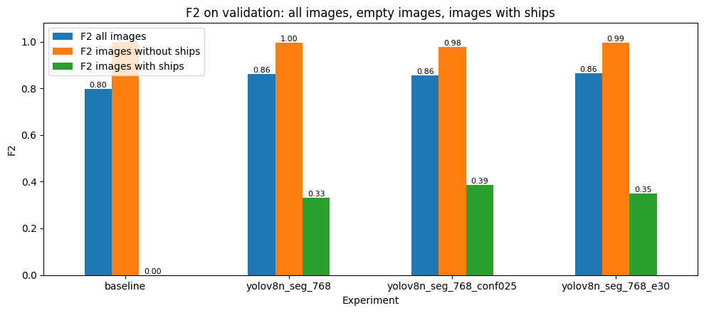
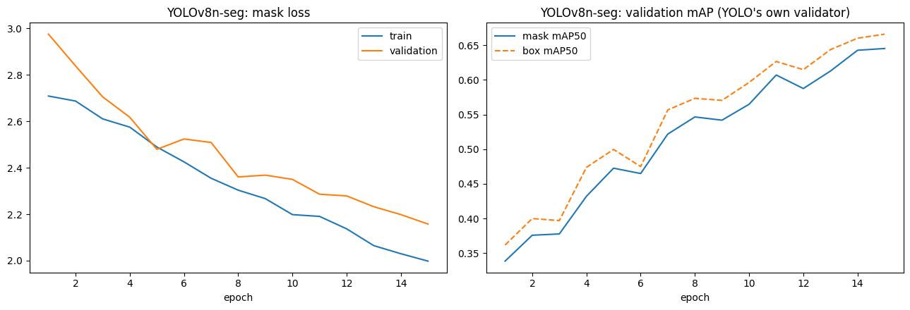
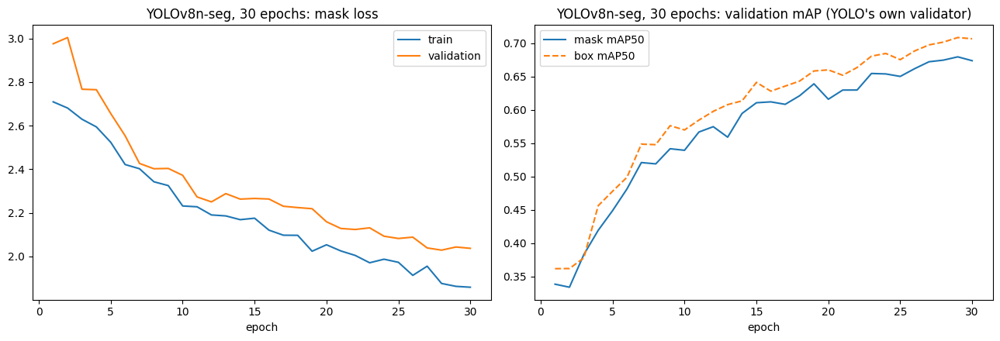
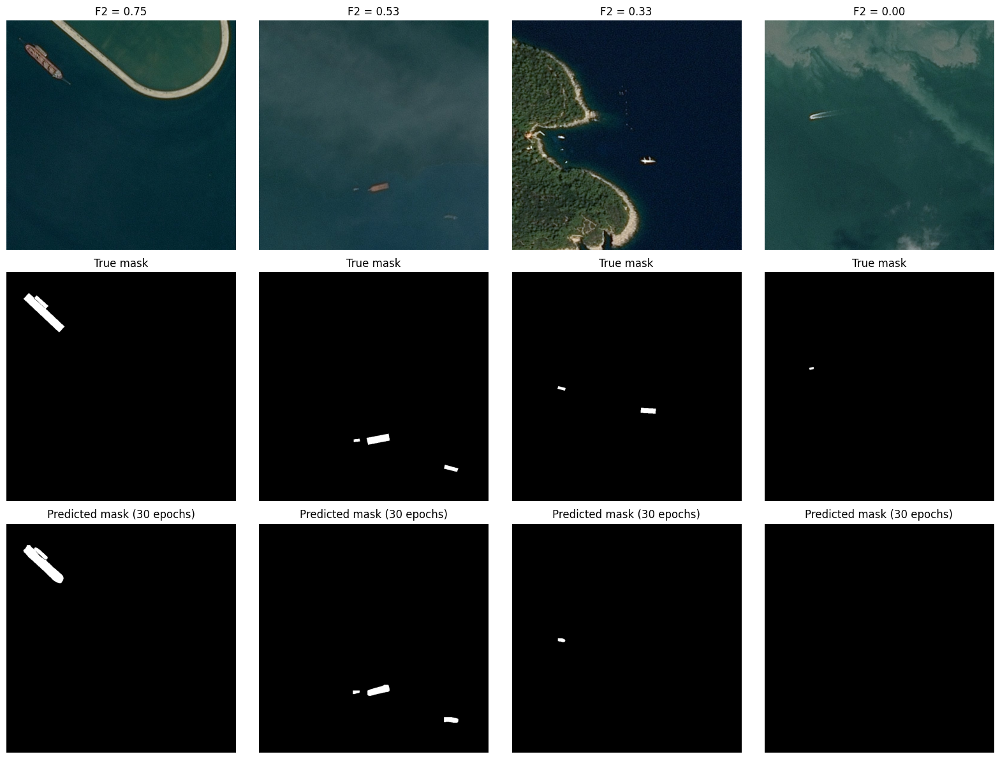

# Airbus Ship Segmentation | YOLOv8-seg + OpenCV

Segmentation of ships on 768×768 satellite images from the [Airbus Ship Detection Challenge](https://www.kaggle.com/competitions/airbus-ship-detection): a fine-tuned YOLOv8n-seg model compared against a trivial baseline.

     ![matplotlib](https://img.shields.io/badge/matplotlib-11557C?logo=data%3Aimage%2Fsvg%2Bxml%3Bbase64%2CPHN2ZyB4bWxucz0iaHR0cDovL3d3dy53My5vcmcvMjAwMC9zdmciIHZpZXdCb3g9IjAgMCAyNTYgMjU2Ij48Y2lyY2xlIGN4PSIxMjgiIGN5PSIxMjgiIHI9IjExMCIgZmlsbD0ibm9uZSIgc3Ryb2tlPSIjZmZmIiBzdHJva2Utd2lkdGg9IjE0Ii8%2BPGc%2BPHBhdGggZmlsbD0iI2ZmZiIgZD0ibTEwNy44IDM2IC4xLjcgMjAuOCA5MS4xLTEuMy43LTU5LjktNzEuOC0uNS0uNi42LS41QTk0IDk0IDAgMCAxIDEwNyAzNi4xeiIvPjxwYXRoIGZpbGw9IiNmZmYiIGQ9Im01NCA5MS41LjYuMyA3My43IDM1LjUtLjIgMS40LTgwLjUgMTQuNi0uNy4yLS4xLS44YTgzIDgzIDAgMCAxIDYuOC01MC41eiIvPjxwYXRoIGZpbGw9IiNmZmYiIGQ9Im0xMjcuNyAxMjcuMy43IDEuM0w5MCAxNTUuMmwtLjYuNS0uNC0uNmE0OCA0OCAwIDAgMS0zLjgtNi41bC0uMy0uNy43LS4zeiIvPjxwYXRoIGZpbGw9IiNmZmYiIGQ9Im0xMjguNyAxMjcuOSA5LjggNTcuNi4yLjctLjguMmE1OSA1OSAwIDAgMS0yMy0uN2wtLjgtLjIuMi0uNyAxMy01N3oiLz48cGF0aCBmaWxsPSIjZmZmIiBkPSJtMTI4LjUgMTI3LjQgNzMuNyA1Ny41LjYuNC0uNS42YTk0IDk0IDAgMCAxLTE1LjUgMTUuOGwtLjYuNS0uNS0uNi01OC4zLTczLjF6Ii8%2BPHBhdGggZmlsbD0iI2ZmZiIgZD0ibTE1MC43IDExOS44LjIuN2EyNCAyNCAwIDAgMSAxLjIgNy41di44aC0yMy42bC4xLTEuOCAyMS40LTd6Ii8%2BPHBhdGggZmlsbD0iI2ZmZiIgZD0ibTE1Mi4yIDYxLjQuNy4yYTcxIDcxIDAgMCAxIDE5LjMgMTFsLjYuNS0uNS41LTQzLjcgNTQuOS0xLjMtLjggMjQuNi02NS42eiIvPjwvZz48Y2lyY2xlIGN4PSIxMjgiIGN5PSIxMjgiIHI9IjYiIGZpbGw9IiNmZmYiLz48L3N2Zz4%3D&style=for-the-badge)

## 📊 Results

Validation set: 2,000 images (1,594 without ships, 406 with ships). Metric: F2, described below.

| Model | F2, all images | F2, images without ships | F2, images with ships |
|---|---|---|---|
| Baseline: predict "no ships" | 0.797 | 1.000 | 0.000 |
| YOLOv8n-seg, conf 0.5 (main) | 0.861 | 0.996 | 0.330 |
| YOLOv8n-seg, conf 0.25 | 0.856 | 0.976 | 0.386 |
| **YOLOv8n-seg, conf 0.5, 30 epochs** | **0.864** | 0.995 | 0.348 |

**Bold** = best result. The main setup (15 epochs, conf 0.5) was fixed before the experiments; each experiment changes one thing in it.

- The model beats the baseline by 0.064, and the whole gain comes from images with ships.
- Tiny ships are the main difficulty: the metric requires near-exact masks, so detected ships often get only partial credit.
- A lower confidence threshold finds more ships but adds false alarms. Since most images are empty, the overall score does not improve (the difference is within noise), so conf 0.5 was kept.
- Longer training: at 15 epochs the curves were still improving, so a second experiment trained for 30 epochs. YOLO's own mask mAP50 rose from about 0.65 to about 0.68 and the curves start to flatten, but our F2 changed only 0.861 → 0.864 (within noise; images with ships 0.330 → 0.348). The bottleneck is not training length but very precise masks of tiny ships, which F2 requires (IoU up to 0.95).

<!-- >>> IMAGE: put results_bars.png (from the Kaggle notebook's Output tab) into the images/ folder <<< -->

*F2 on validation for each setup, split into all images, empty images and images with ships.*

<!-- >>> IMAGE: put yolo_seg_curves.png (from the Kaggle notebook's Output tab) into the images/ folder <<< -->

*Main model (15 epochs): mask loss (left) and YOLO's own mask and box mAP50 (right). Both are still improving at the last epoch.*

<!-- >>> IMAGE: put examples.png (from the Kaggle notebook's Output tab) into the images/ folder <<< -->

*Four validation images with ships: photo with its F2 (top), true mask (middle), mask predicted by the 15-epoch model (bottom).*

<!-- >>> IMAGE: put yolo_seg_curves_e30.png (from the Kaggle notebook's Output tab) into the images/ folder <<< -->

*The same curves for the 30-epoch experiment: mAP50 starts to flatten.*

<!-- >>> IMAGE: put examples_e30.png (from the Kaggle notebook's Output tab) into the images/ folder <<< -->

*The same four images, predicted by the 30-epoch model.*

## 🛠️ Approach

1. **Data.** ~192,000 images, ~78% of them without ships. Training subset: 5,000 images, 80% with ships so the model sees enough examples. Validation: 2,000 images with the natural ratio.
2. **Labels.** RLE masks decoded and converted to YOLO polygons (largest contour per ship, OpenCV).
3. **Model.** Pretrained YOLOv8n-seg, fine-tuned for 15 epochs at 768 px, seed 42.
4. **Experiments.** One change each: confidence threshold lowered from 0.5 to 0.25; 30 epochs instead of 15.

## 📏 Metric

Because most images are empty, accuracy is misleading. Instead, a simplified version of the competition metric is used:

- Per image: F2 = 5·TP / (5·TP + 4·FN + FP), averaged over IoU thresholds 0.5–0.95. A missed ship costs 4× more than a false alarm.
- An empty image scores 1 if nothing is predicted, otherwise 0.
- The final score is the mean over images, also reported separately for empty images and images with ships.

## ⚠️ Limitations

- Small training subset (5,000 of ~192,000 images); 15 epochs for the main model (30 in an experiment).
- Only 406 validation images contain ships, so differences below ~0.01 may be noise.
- The threshold was compared on the validation set itself, with no separate test set, so the scores are slightly optimistic.
- Simplified metric (no one-to-one matching of predictions to ships) and no Kaggle leaderboard submission.
- Single run; GPU training may vary by about ±0.005 between runs.

## ▶️ How to run

Open the notebook on Kaggle with the competition data attached, enable GPU and Internet, and Run All (~1.5 hours, two models are trained).
Outputs in `/kaggle/working`: `results.csv` (the table above), `val_scores_*.csv` (per-image scores), the figures above and `runs/` (model weights).
